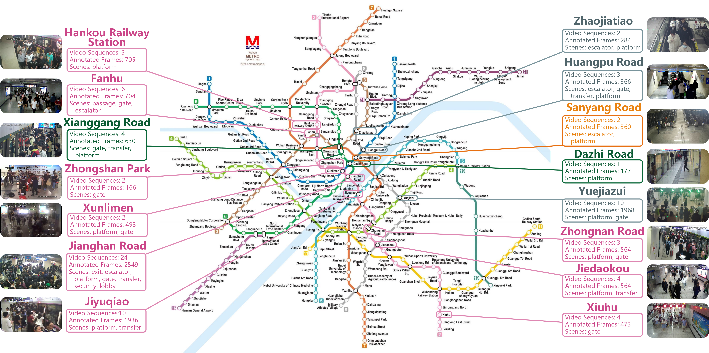
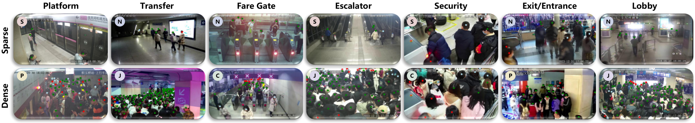
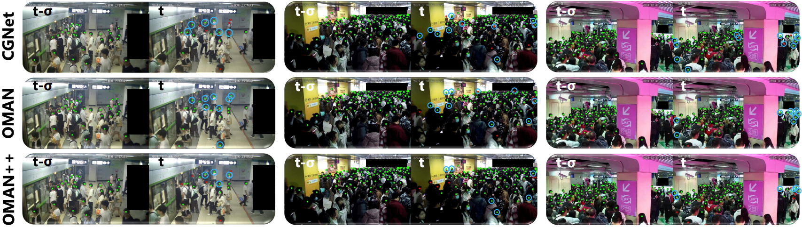
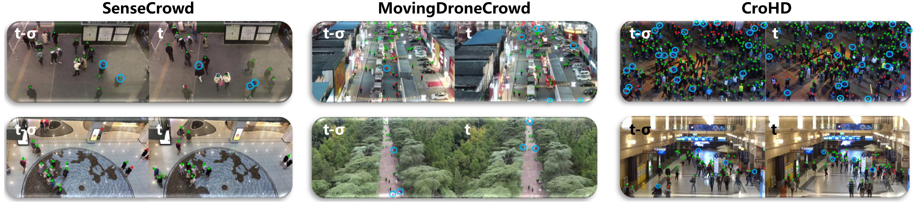
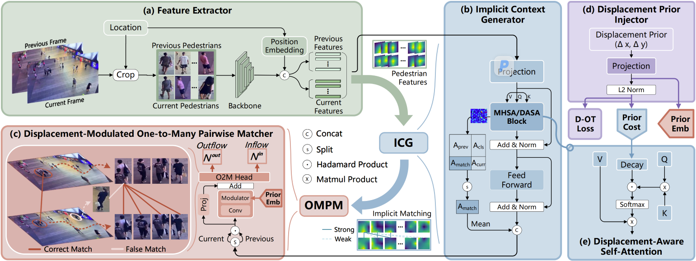

# Crowded Video Individual Counting Informed by Social Grouping and Spatial-Temporal Displacement Priors (OMAN++)

This repository includes the implementation of the manuscript: 
[**Crowded Video Individual Counting Informed by Social Grouping and Spatial-Temporal Displacement Priors**](https://github.com/tiny-smart/OMAN),
Transaction on Image Processing (TIP 2026)

Hao Lu<sup>1</sup>, Xuhui Zhu<sup>1</sup>, Wenjing Zhang<sup>1</sup>, Yanan Li<sup>2</sup>, Xiang Bai<sup>1</sup>
<sup>1</sup>Huazhong University of Science and Technology, China
<sup>2</sup>Wuhan Institute of Technology, China

[[Manuscript]](doc/OMAN++.pdf) | Transaction Version (todo) | [[Previous Conference Version (OMAN, ICIP 2025)]](https://arxiv.org/abs/2506.13067) | [[Code]](https://github.com/tiny-smart/OMAN)



## Highlights
- **First Surveillance-view VIC Dataset**: WuhanMetroCrowd dataset features crowded, dynamic pedestrian flows from 7 metro station scenes, with severe occlusions and large variations. Each pedestrian is manually annotated as `pedestrian`, `inflow`, `outflow`, or `both`, and indiscernible regions are masked.
<p align="center">
  
</p>

- **High Performance**: OMAN++ outperforms all existing methods and achieves robust counting performance, especially in crowded scenarios.
<p align="center">
  
</p>

<p align="center">
  
</p>


## Overview

Video Individual Counting (VIC) estimates foot traffic by counting unique pedestrians in a video. Existing methods primarily rely on appearance-based O2O matching, limiting performance in crowded scenes.

This work revisits VIC through two informative priors:
- Social grouping prior: pedestrians often form groups, motivating O2M matching through ICG and OMPM;
- Spatial-temporal displacement prior: pedestrians cannot teleport, motivating DPI that extracts motion through DASA, a displacement modulator, and D-OT loss.



### What's New Compared with OMAN (ICIP 2025)

- A novel crowded VIC benchmark, WuhanMetroCrowd, featuring long sequences, large density/flow variations, and severe occlusions;
- The spatial-temporal displacement prior, working in synergy with the social grouping prior;
- Comprehensive experiments on four benchmarks with consistent improvements over the state of the art.

## Repository Structure

```
OMAN++
├── train.py                  # training entry
├── test.py                   # inference on SenseCrowd
├── test_Metro.py             # inference on WuhanMetroCrowd
├── engine.py                 # training / evaluation loops
├── eval_metrics_Drone.py     # evaluation on MovingDroneCrowd
├── eval_metrics_Metro.py     # evaluation on WuhanMetroCrowd
├── models/
│   ├── pet.py                # locator (PET) + VIC pipeline
│   ├── vic.py                # ICG + OMPM (coarse-to-fine matcher) + displacement encoder
│   ├── tri_sim_ot_b.py       # displacement-informed optimal transport (D-OT) loss
│   ├── transformer/          # transformer encoder with DASA
│   └── backbones/            # ConvNeXt-S / VGG16 backbones
└── datasets/                 # SenseCrowd / HT21 / Metro / UAVVIC / MovingDroneCrowd loaders
```

## Installation

Clone and set up the OMAN repository:

```
git clone https://github.com/tiny-smart/OMAN
cd OMAN
conda create -n OMAN++ python=3.9
conda activate OMAN++
pip install -r requirements.txt
```

> Note: OMAN++ shares the environment and the `requirements.txt` (e.g., `torch==2.0.1`, `torchvision==0.15.2`, `timm==0.9.2`, `geomloss==0.2.6`) at the repository root..

## Data Preparation

| Dataset | View | Frame Interval σ | Annotation |
| :-- | :-- | :-- | :-- |
| SenseCrowd | Surveillance | 15 (3s) | ID |
| CroHD (HT21) | Drone | 75 (3s) | ID |
| MovingDroneCrowd | Drone | 4 | ID |
| UAVVIC | Drone | 1 (3s) | In/Out |
| **WuhanMetroCrowd (Ours)** | Surveillance | 1 (2s) | In/Out |

- SenseCrowd / CroHD / MovingDroneCrowd / UAVVIC: please prepare the datasets following their official instructions.
- **WuhanMetroCrowd [Final Version]**: [[Baidu disk]](https://pan.baidu.com/s/108pYcxp1JkNaV27K1O6Ivg?pwd=jt3h) or [[Google disk]](https://drive.google.com/file/d/1qin0o5TGU0QrFR0AA3weFYY62rWDgyTh/view?usp=share_link). Based on the preview version reported in the paper, we have thoroughly re-inspected the dataset and rectified annotation errors. We will report OMAN++'s result on final version in this repo.

## A Quick Demo
```
todo
```


## Inference

- To test OMAN++ on different datasets, run

```
# SenseCrowd
python test.py

# WuhanMetroCrowd
python test_Metro.py
```

Checkpoint paths can be changed via `--resume`. Results are saved to `outputs/json/video_results_test.json`.

## Evaluation

- To evaluate the results after testing, run the corresponding evaluation script:

```
# MovingDroneCrowd
python eval_metrics_Drone.py

# WuhanMetroCrowd
python eval_metrics_Metro.py
```

## Results
- WuhanMetroCrowd-Preview
Results on *WuhanMetroCrowd-Preview* (80 clips, 11,925 frames, 223,662 annotations).

| Dataset | MAE ↓ | MSE ↓ | WRAE ↓ | Checkpoint |
| :--: | :--: | :--: | :--: | :--: |
| CGNet | - | - | - | -|
| SDNet | - | - | - | [[Baidu]]() [[Google]]() |
| OMAN | - | - | - | [[Baidu]]() [[Google]]() |
| **OMAN++** | **87.1** | **160.2** | **19.8%** | [[Baidu]](https://pan.baidu.com/s/1Cfyq3mV-CleJwDlvXlww5A?pwd=g9j2) [[Google]](https://drive.google.com/drive/folders/1lvLWBbbTAPY9jOxBj9MMkYXXLQ7CYuQN?usp=share_link) |


- WuhanMetroCrowd-Final
Results on *WuhanMetroCrowd-Final* (80 clips, 11,925 frames, 207,545 annotations).

| Dataset | MAE ↓ | MSE ↓ | WRAE ↓ | Checkpoint |
| :--: | :--: | :--: | :--: | :--: |
| CGNet | 99.1 | 142.6 | 38.9% | [[Baidu]]() [[Google]]() |
| SDNet | 151.8 | 415.4 | 31.1% | [[Baidu]]() [[Google]]() |
| OMAN | - | - | - | [[Baidu]]() [[Google]]() |
| **OMAN++** | **-** | **-** | **-** | [[Baidu]]() [[Google]]() |

## Citation

If you find this work helpful for your research, please consider citing:

```
@article{OMAN++,
  author={Hao Lu, Xuhui Zhu, Wenjing Zhang, Yanan Li, Xiang Bai},
  booktitle={IEEE Transaction on Image Processing}, 
  title={Crowded Video Individual Counting Informed by Social Grouping and Spatial-Temporal Displacement Priors}, 
  year={2026},
  volume={},
  number={},
  pages={},
  keywords={Video individual counting, foot traffic, one-to-many matching, displacement priors},
  doi={}}
```

## Permission

This code is for academic purposes only. Contact: Xuhui Zhu (XuhuiZhu@hust.edu.cn)
For commercial use, Contact: Hao Lu (hlu@hust.edu.cn)

## Acknowledgement

We thank FiberHome Telecommunication Technologies Co., Ltd. and Wuhan Metro Group Co., Ltd. for sharing the data of WuhanMetroCrowd.
